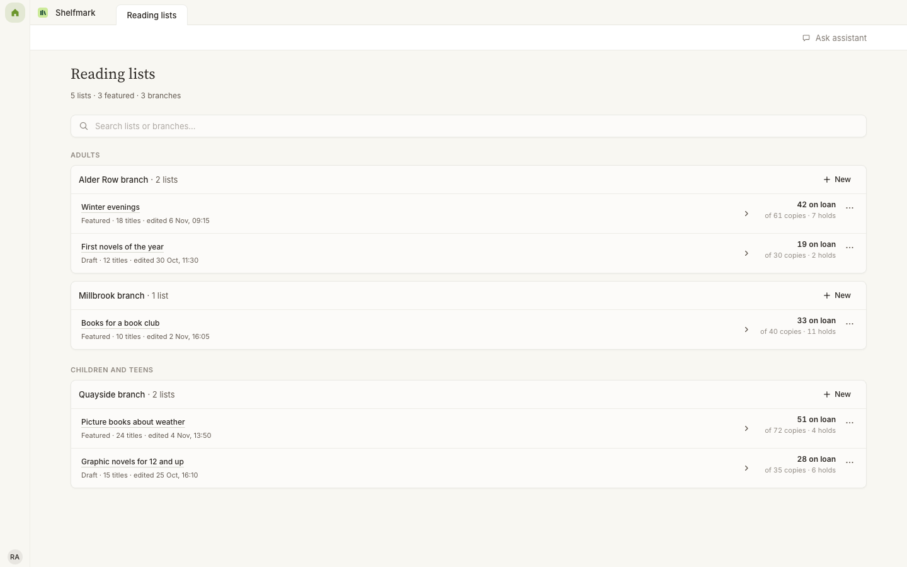
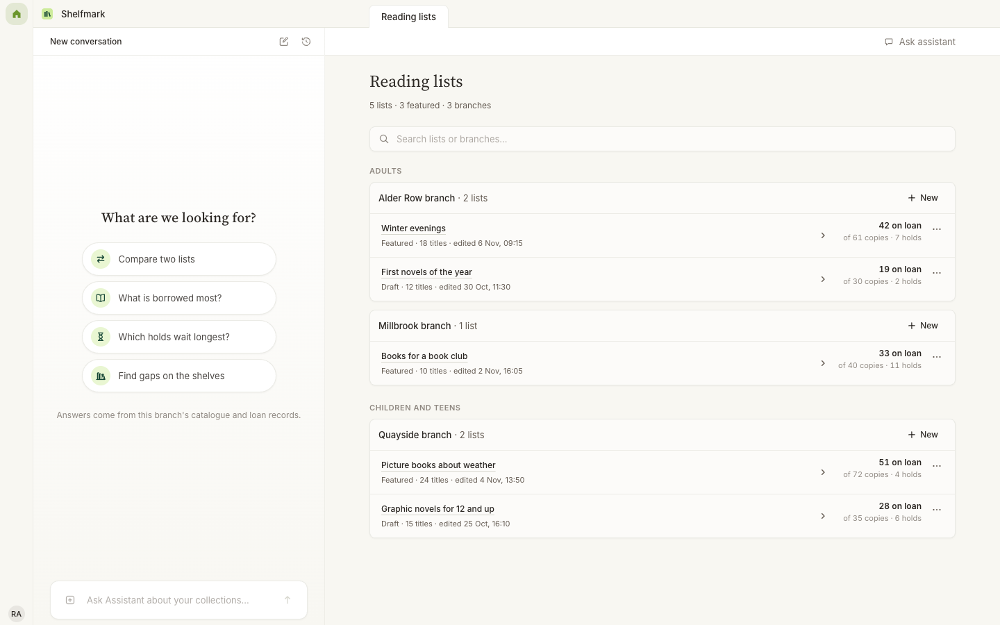

# WhiteSpace brand

How WhiteSpace products look and sound.

## Colours

| Role | Value | Use |
|---|---|---|
| Background | `#FFFFFF` | Cards, fields and header bars, set on the warm canvas |
| Surface | `#FAF9F5` | Menus, popovers and other raised areas |
| Muted | `#F8F7F2` | The warm page canvas |
| Text | `#2A2622` | Body text, names and titles |
| Muted text | `#625950` | Meta lines and secondary text; the same colour at 70% or 50% opacity for section labels, captions and placeholders |
| Border | `#D6D6CD` | Hairlines, used at half strength or less |
| Primary | `#6C962C` | Where you are and the one main action; a pale tint behind the current icon |
| Deep green | `#174736` | Small icons and text on lime |
| Lime | `#CDEB9B` | The logo mark and soft round chips behind small icons, used sparingly |
| Callout | `#F3FFDB` | Background of a note that deserves notice |
| Attention | `#CB593B` | Warnings only |

Terracotta (`#CB593B`) is for warnings only: something late, wrong or at risk. Never use it for decoration or emphasis.

Primary green is for marks and fills, not for text. When text needs to be green, use deep green.

Most of the screen stays neutral: a warm off-white canvas, white cards and dark warm text. Green and lime appear in small doses.

## Type

- Inter for interface text: lists, labels, fields, buttons.
- Source Serif 4 for page titles and other large headings.
- Size scale: 11, 12, 13, 20 and 24 px. Most text is 12 px; names, fields and tabs are 13 px; meta lines and section labels are 11 px; serif headings are 20 or 24 px.
- Weights 400 for reading, 500 for names, links and buttons, 600 for figures and section labels. Serif titles stay at 400 or 500.
- Sentence case everywhere, except small section labels: 11 px, uppercase, letter-spaced, in a lighter muted text.
- Figures use tabular numbers. Meta lines join short facts with middots: "5 lists · 3 featured".

## Feel

Calm, light and low in contrast, with a lot of air. A warm off-white canvas carries white cards and fields, each with a hairline border at half strength and at most a faint, short shadow. No heavy shadows and no colour gradients; at most a slow fade from white into the canvas. Corners are soft: 8 px on cards, fields and tabs, up to 12 px on larger boxes, fully round on pill buttons, chips and avatars. Actions are quiet: a text button with a small icon or a faint tint, never a heavy solid block of colour. Green marks where you are, terracotta marks what is wrong.

## Voice

Plain, specific and calm. Short sentences in sentence case. Say what happened and what to do next. Name things the way the people using the product name them. Give exact numbers and dates ("42 on loan", "edited 6 Nov, 09:15"). No exclamation marks, no hype, no apologies.

Two examples of the look. Neither is a layout we expect.
